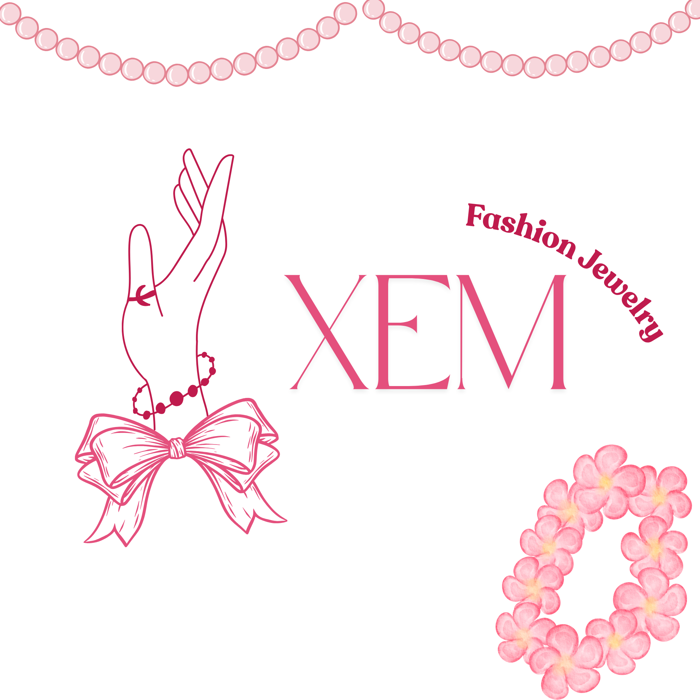
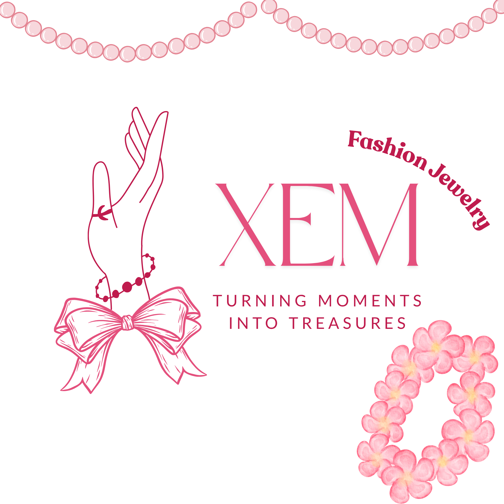
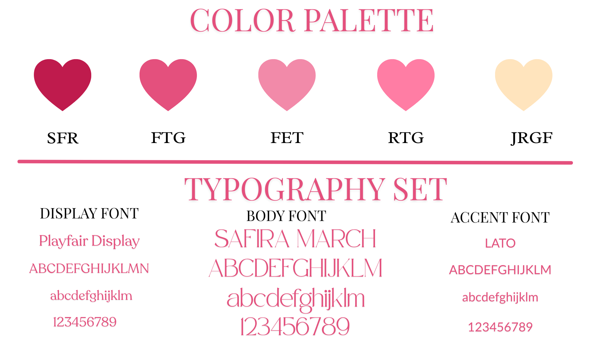
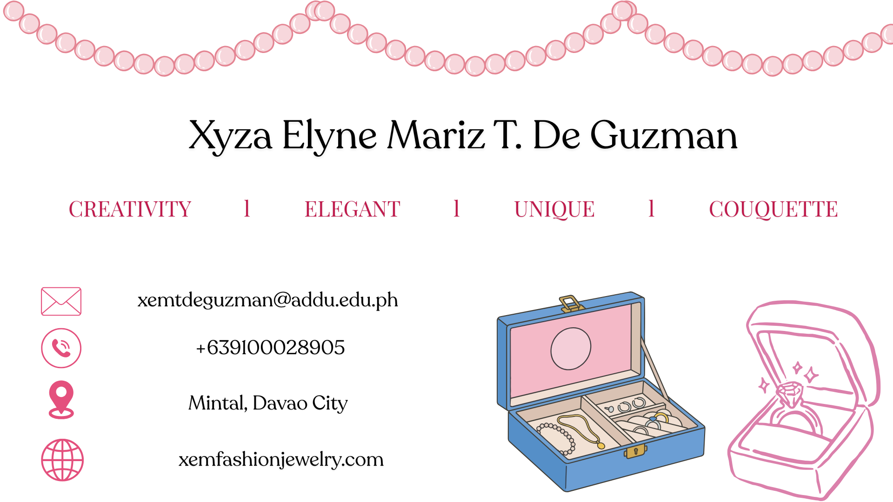

# 💜 ˚₊‧꒰ა ACTIVITY 2 ໒꒱ ‧₊˚

## 🎨 Color Palette & Typography

### ✦ Personal Branding: XEM Fashion Jewelry ✦

🌷 *GE 4120 — Presentation Design* 🌷

╭──────────────────────────────╮  
💜 ✨ 🎀 🪻 🦋 🎀 ✨ 💜  
╰──────────────────────────────╯

---

## 🪻 About the Activity

**Activity 2: Color Palette and Typography** focuses on selecting appropriate
colors and typography to establish a clear visual identity.

For this activity, I created a personal branding concept for **XEM Fashion
Jewelry**, including a logo and a tagline:

> 🎀 **"TURNING MOMENTS INTO TREASURES"**

The design combines fashion, femininity, elegance, and sentimental value to
create a visual identity appropriate for a jewelry brand.

---

## 🌸 My Design Output 🌸

### 💎 Personal Logo

  

### 🎀 Logo with Tagline

  

### 🎨 Color Palette & Typography Set

  

### 💌 Business Card

  

---

## 🎨 Chosen Color Palette

The main color palette of my design consists of **pink, rose, and white
tones**.

### 🌷 Pink

Pink is the dominant color used throughout the design. I selected it because
it represents **femininity, softness, beauty, and elegance**, which are
appropriate qualities for a fashion jewelry brand.

The different shades of pink also give the logo a youthful and delicate
appearance while helping the brand feel warm and approachable.

### 💗 Rose / Dark Pink

The darker pink or rose tone provides **contrast and emphasis**. It is used
for important elements such as the words **"Fashion Jewelry"** and parts of
the logo.

This darker shade helps important details stand out while maintaining the
feminine character of the design.

### 🤍 White

White serves as the background and provides **clean visual space** around the
design elements. It allows the pink typography, illustrations, and decorative
elements to become more noticeable.

The white background also contributes to the **clean and elegant appearance**
of a jewelry brand.

---

## 💜 Why I Chose These Colors

I chose pink and rose tones because they communicate the **feminine,
elegant, delicate, and fashionable** qualities that I want the XEM Fashion
Jewelry brand to represent.

The combination of pink with white creates a soft and clean appearance,
while the darker rose accents provide enough contrast to keep the logo
visually interesting.

Together, the colors create a **cohesive and recognizable visual identity**
that fits the concept of fashion jewelry.

---

## ✨ Typography

Typography was an important part of creating the identity of **XEM Fashion
Jewelry**.

### 💎 Main Logo Typography

The large **"XEM"** uses an elegant serif-style typeface. Its thin and
refined letterforms create a sophisticated and luxurious appearance.

This typography was selected because it resembles the visual style commonly
associated with **fashion, beauty, and jewelry branding**.

### 🎀 "Fashion Jewelry"

The words **"Fashion Jewelry"** use a more decorative and expressive
type treatment. Its curved arrangement adds movement and personality to the
logo.

It also reinforces the fashion-oriented identity of the brand.

### 🌷 Tagline Typography

The tagline:

> **TURNING MOMENTS INTO TREASURES**

uses a clean, spaced-out uppercase style.

The increased letter spacing makes the tagline feel modern and refined while
keeping it readable. It also gives the tagline enough visual separation from
the main logo.

---

## 🦋 Why I Chose This Typography

I chose a combination of **elegant and readable typography** because I wanted
the logo to look sophisticated without becoming difficult to understand.

The serif typography gives **XEM** a luxurious and fashionable appearance,
while the simpler tagline typography provides balance and readability.

The combination creates a visual identity that feels **elegant, feminine,
modern, and appropriate for a jewelry brand**.

---

## 🎀 Supporting Visual Elements

The design also incorporates several decorative elements that reinforce the
brand's personality:

| ✦ Element | Purpose |
|:---:|:---|
| 🎀 **Bow** | Represents femininity, charm, and fashion |
| 💎 **Jewelry-inspired details** | Reinforces the jewelry concept |
| 🖐️ **Hand illustration** | Creates a connection with wearing and presenting jewelry |
| 🌸 **Flowers** | Adds softness, beauty, and femininity |
| 📿 **Beaded decoration** | Supports the jewelry theme |
| ✨ **Decorative typography** | Creates an elegant fashion-oriented identity |

---
