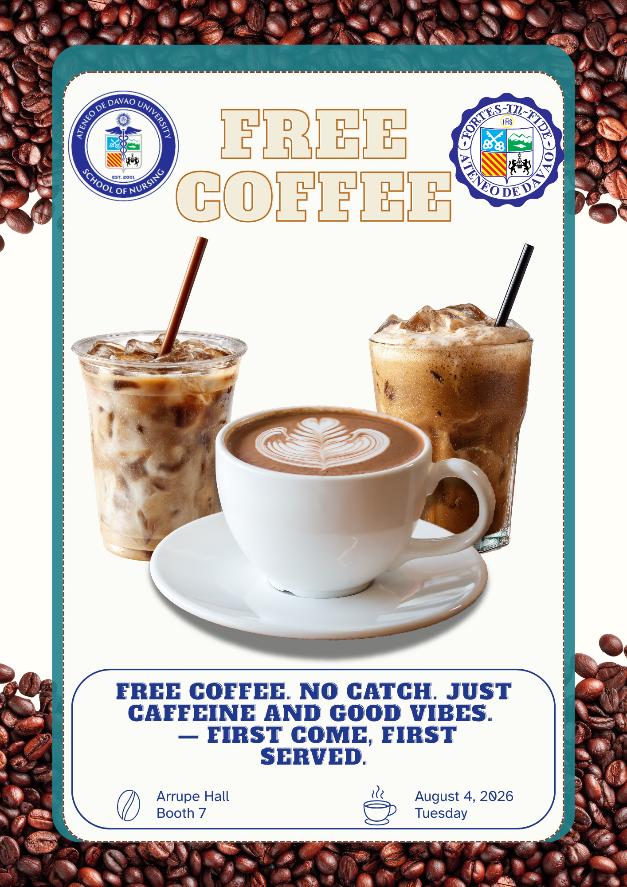
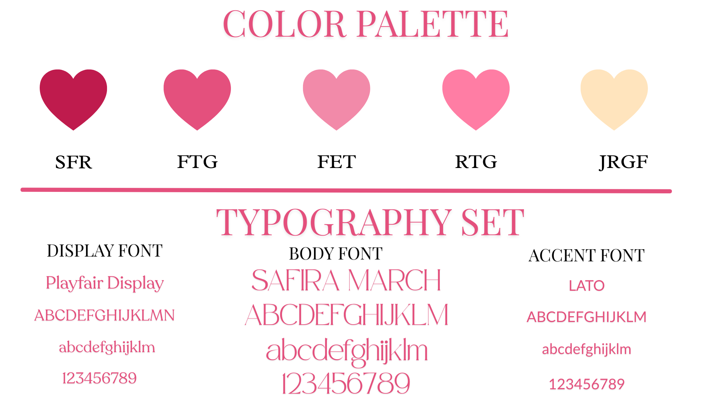
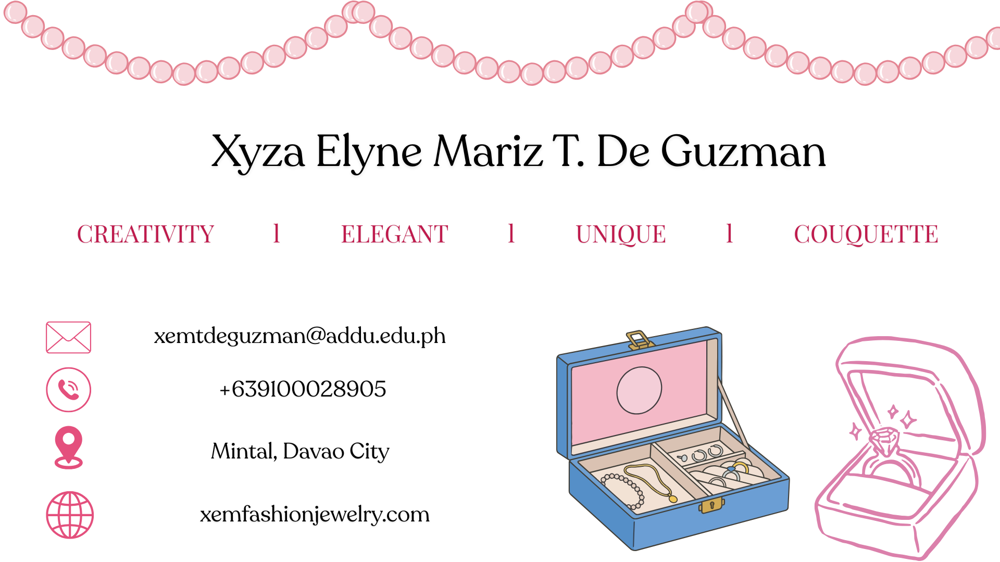
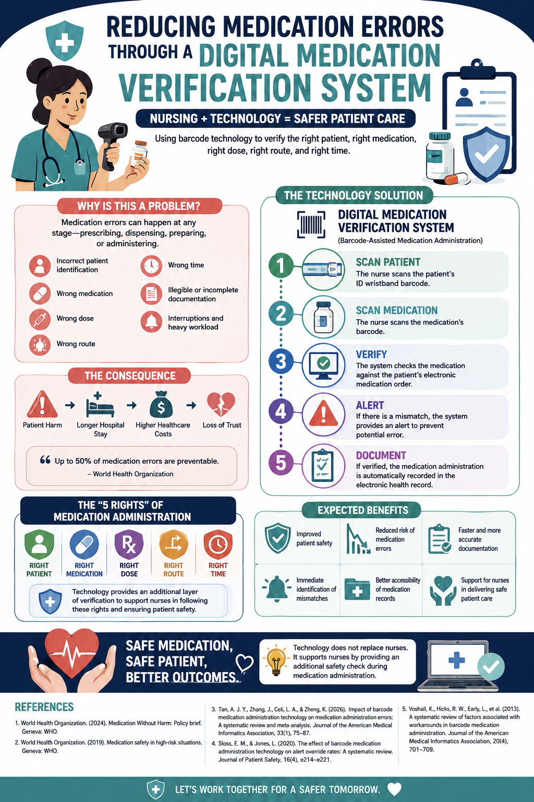

<!-- PINK WAVE HEADER -->

  

<h1 align="center">୨୧ Welcome to My Digital Portfolio ୨୧</h1>

  <i>A collection of my activities, creative outputs, and learning experiences in 21st Century IT Skills.</i>

  <b>Xyza Elyne Mariz T. De Guzman</b> 
  BSN 4F | Ateneo de Davao University 
  GE 4120 – 21st Century IT Skills

  🎀 ──────────────── 🎀

## ♡ About This Portfolio

Welcome to my digital portfolio! This repository contains my completed activities and outputs for GE 4120 – 21st Century IT Skills.

Throughout these activities, I explored different digital tools and technologies, including presentation design, color and typography, infographic creation, Google Sheets, AI prompt engineering, website development, and professional portfolio preparation.

Each activity represents an opportunity to develop my creativity, digital literacy, communication, and technology skills as a nursing student.

---

## 🎀 My Activities

### ୨୧ Activity 1 — Presentation Design Principles

**Project:** Free Coffee Promotional Presentation

This activity focused on applying fundamental presentation design principles to create an engaging promotional presentation. It demonstrated the importance of contrast, visual hierarchy, balance, alignment, repetition, proximity, and consistency.

  

**What I learned:**
- Apply essential presentation design principles.
- Organize information through visual hierarchy.
- Create visually appealing and understandable slides.

📄 **[View Activity 1 Documentation](Activity1.md)**

---

### ୨୧ Activity 2 — Color Palette & Typography

**Project:** Personal Branding – XEM Fashion Jewelry

This activity explored how color palettes and typography contribute to brand identity. The project featured a pink, rose, and white aesthetic, incorporating elegant typography and decorative elements to create a cohesive visual identity.

  
  

  
  

**Tagline:** *TURNING MOMENTS INTO TREASURES*

**What I learned:**
- Choose colors that communicate a brand's identity.
- Combine typography styles effectively.
- Maintain visual consistency across branding materials.

📄 **[View Activity 2 Documentation](Activity2.md)**

---

### ୨୧ Activity 3 — Social Media Infographics

**Project:** Reducing Medication Errors Through a Digital Medication Verification System

This activity involved creating an infographic about the use of Barcode Medication Administration (BCMA) and electronic Medication Administration Records (eMAR) to promote medication safety in healthcare settings.

  

**Key concepts:**
- Right patient
- Right medication
- Right dose
- Right route
- Right time

**What I learned:**
- Present healthcare information through infographics.
- Communicate important concepts using visual elements.
- Understand how digital technology supports patient safety.

📄 **[View Activity 3 Documentation](Activity3.md)**

---

### ୨୧ Activity 4 — Google Sheets

**Project:** Google Sheets Presentation | Group 3

This activity explored Google Sheets as a digital spreadsheet tool for organizing, analyzing, and presenting information. It covered its interface, collaboration features, formulas, functions, formatting, sorting, filtering, and charts.

**Topics covered:**
- Introduction and purposes of Google Sheets
- Interface and basic navigation
- Collaboration and sharing permissions
- Sorting and filtering
- Charts and data visualization
- Formatting and data validation
- Autosave and version history
- Formulas and functions
- Practical applications in nursing

**What I learned:**
- Organize and manage data efficiently.
- Use formulas and functions for calculations.
- Collaborate with others using online spreadsheets.
- Recognize the applications of spreadsheets in healthcare.

📄 **[View Activity 4 Documentation](Activity4.md)**

📎 **[Open Google Sheets Presentation (PDF)](Activity-4-Google-Sheets-Presentation.pdf)**

---

### ୨୧ Activity 5 — AI Prompt Engineering

**Project:** Myasthenia Gravis – Nursing Education

This activity demonstrated how artificial intelligence can support learning through effective prompt engineering. Using ChatGPT, I compared a simple prompt with an improved and more detailed prompt to generate organized nursing-related educational content about Myasthenia Gravis.

**Topics covered:**
- Pathophysiology
- Signs and symptoms
- Diagnostic procedures
- Medical treatment
- Nursing management
- Myasthenic crisis and cholinergic crisis
- Nursing diagnoses

**What I learned:**
- Construct clear and specific AI prompts.
- Improve the quality and organization of AI-generated responses.
- Use AI as a learning aid while applying critical thinking.
- Verify generated information before using it academically.

📄 **[View Activity 5 Documentation](Activity5.md)**

📎 **[Open Myasthenia Gravis Activity (PDF)](activity5-myasthenia-gravis.pdf)**

---

### ୨୧ Activity 6 — Website Development

**Project:** Less Plastic, More Life

This activity involved creating a one-page environmental advocacy website promoting plastic reduction and sustainable living.

The website features a nature-inspired design using forest green, deep green, mint, and cream colors, with typography selected to support its environmental theme.

**Website features:**
- Responsive website layout
- Environmental awareness content
- Sustainable lifestyle recommendations
- Interactive pledge form
- Pledge counter using local storage
- Smooth navigation

**Technologies used:**
- HTML5
- CSS3
- JavaScript
- Google Fonts
- GitHub Pages

**What I learned:**
- Understand the basic structure of a website.
- Apply HTML, CSS, and JavaScript.
- Create interactive website features.
- Use digital platforms to promote environmental awareness.

  🌱 **LESS PLASTIC, MORE LIFE** 🌱

  

📄 **[View Activity 6 Documentation](Activity6.md)**

🌐 **[Open Less Plastic, More Life Website](https://claude.ai/share/018909c5-18a4-48a8-a20e-5b538eed6668)**

---

### ୨୧ Activity 7 — Resume & Professional Portfolio

**Project:** Personal Resume

This activity focused on preparing a professional resume that presents my educational background, clinical experiences, skills, and relevant learning experiences as a nursing student.

**Resume highlights:**
- Educational background
- Clinical exposure and experiences
- Nursing-related skills
- Seminars and training
- Professional development

**What I learned:**
- Organize professional information effectively.
- Present academic and clinical experiences.
- Develop a professional resume.
- Recognize the importance of maintaining a professional portfolio.

📄 **[View Activity 7 Documentation](Activity7.md)**

📎 **[View My Resume (PDF)](resume.pdf)**

📎 **[Open Activity 7 PDF Documentation](DE%20GUZMAN_ACTIVITY7.pdf)**

---

## ♡ Complete File Collection

All activity pages and supporting files are organized in this repository.

| Activity | Documentation | Supporting File / Output |
|:--|:--|:--|
| Activity 1 | [Activity1.md](Activity1.md) | [Free Coffee Image](activity1-free-coffee.png) |
| Activity 2 | [Activity2.md](Activity2.md) | [Logo](logo.png) · [Tagline](tagline.png) · [Palette](palette.png) · [Card](card.png) |
| Activity 3 | [Activity3.md](Activity3.md) | [Infographic](infographic.png) |
| Activity 4 | [Activity4.md](Activity4.md) | [Presentation PDF](Activity-4-Google-Sheets-Presentation.pdf) |
| Activity 5 | [Activity5.md](Activity5.md) | [Activity PDF](activity5-myasthenia-gravis.pdf) |
| Activity 6 | [Activity6.md](Activity6.md) | [Visit Website](https://claude.ai/share/018909c5-18a4-48a8-a20e-5b538eed6668) |
| Activity 7 | [Activity7.md](Activity7.md) | [Resume](resume.pdf) · [Activity PDF](DE%20GUZMAN_ACTIVITY7.pdf) |

---

## ♡ About the Creator

  <b>XYZA ELYNE MARIZ T. DE GUZMAN</b> 
  Bachelor of Science in Nursing 
  Ateneo de Davao University

As a nursing student, I recognize the importance of technology in education, communication, and healthcare. This portfolio reflects my learning journey and my efforts to develop the digital skills necessary for academic and professional growth.

I hope to continue learning, exploring new technologies, and applying these skills to improve my future nursing practice.

---

  🎀 <i>Learning, creating, and growing through technology.</i> 🎀

  Made with ♡ by Xyza Elyne Mariz T. De Guzman

<!-- PINK WAVE FOOTER -->

  

